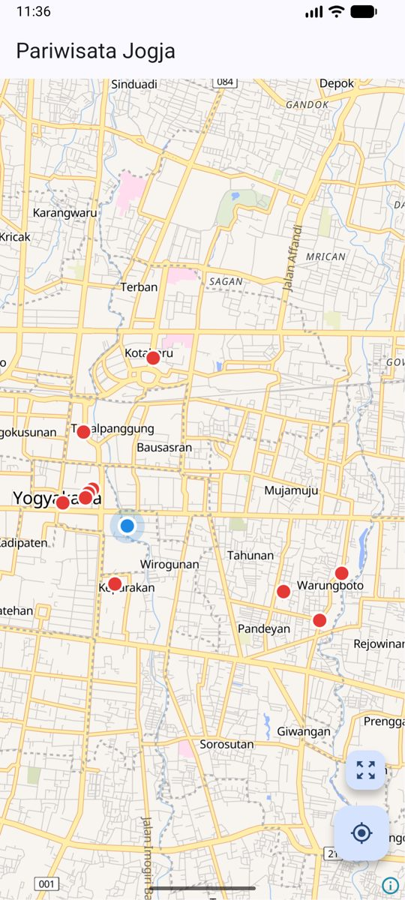
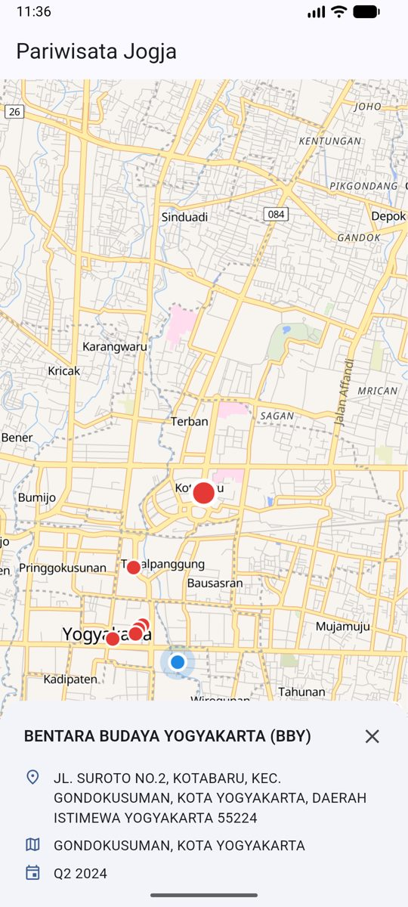

# MAPID Map — Mobile Developer Case Study

A Flutter app that shows a GEO MAPID data layer on top of an OpenFreeMap basemap using MapLibre GL, with feature popups and the user's current location.

<p>
  
  &nbsp;&nbsp;
  
</p>

## Features

- **Basemap** — OpenFreeMap [Liberty](https://tiles.openfreemap.org/styles/liberty) style rendered with [`maplibre_gl`](https://pub.dev/packages/maplibre_gl).
- **GEO MAPID layer** — points from the GEO MAPID `get_layer` endpoint, drawn as a native circle layer above the basemap with name labels at higher zoom levels. The camera fits all points on load.
- **Popup** — tapping a point highlights it and opens a sheet with its name, address, district/city and period. Tapping the map or the close button dismisses it.
- **User location** — requests permission, gets the current GPS position and shows it as a live-updating dot. The location button centers the map on the user.
- **Resilience** — loading indicator, error banner with retry for the layer request, and clear messages (with a shortcut to settings) when location permission is denied or location services are off.

## Getting started

### Prerequisites

- Flutter 3.44+ (Dart 3.12+)
- Android SDK
- **JDK 21 installed** — `maplibre_gl` compiles against Java 21. The project selects JDK 21 through a Gradle toolchain in `android/`, so the machine-wide JDK used by other projects does not need to change.

### Configure credentials

The API key and layer identifiers are read from a `.env` file that is not committed.

```bash
cp .env.example .env
```

Then fill in the values:

```env
MAPID_BASE_URL=https://geoserver.mapid.io
MAPID_API_KEY=<api key>
MAPID_LAYER_ID=<layer id>
MAPID_PROJECT_ID=<project id>
```

### Run

```bash
flutter pub get
flutter run
```

### Build APK

```bash
flutter build apk --release
# or smaller, per-architecture APKs
flutter build apk --release --split-per-abi
```

### Test

```bash
flutter test
```

## Project structure

```
lib/
├── main.dart                       # Loads .env, wires services, runs the app
├── app.dart                        # MaterialApp and theme
├── core/
│   ├── config/env.dart             # Typed access to .env values
│   ├── constants/map_constants.dart
│   ├── errors/app_exception.dart
│   ├── theme/app_theme.dart
│   └── utils/text_sanitizer.dart
├── data/
│   ├── models/                     # MapLayer, LayerFeature, DeviceLocation
│   └── services/
│       ├── mapid_layer_service.dart
│       └── location_service.dart
└── features/map/
    ├── map_screen.dart             # UI composition and map event handling
    ├── map_view_model.dart         # Screen state (ChangeNotifier)
    ├── map_layer_renderer.dart     # All MapLibre source/layer/camera calls
    └── widgets/                    # Popup, action buttons, error banner
```

## Design notes

- **Separation of concerns.** Services handle I/O and return plain models, `MapViewModel` owns screen state, and `MapLayerRenderer` is the only place that talks to MapLibre's layer and camera APIs. The screen connects the three. State management uses `ChangeNotifier` from the Flutter SDK, which is enough for a single screen.
- **Native layers instead of annotations.** The data is added as a GeoJSON source with circle and symbol layers, so it is styled and hit-tested by the map engine. The user position is its own layer as well, which keeps it above the data layer.
- **Tap handling.** `maplibre_gl` routes taps on interactive layers to `onFeatureTapped` rather than `onMapClick`, so the popup listens to `onFeatureTapped` and `onMapClick` is only used to dismiss it.
- **Data cleanup.** Some names in the source data contain corrupted characters (e.g. `TAMAN WARUNGBOTO (ʦ�ʦ�…)`). `TextSanitizer` removes these groups before the text is shown in labels or popups.
- **Credentials.** The API key lives in `.env`, which is git-ignored, and never appears in source code. Because `flutter_dotenv` bundles `.env` as an asset, the key is still present inside the built APK; this is inherent to any client-side key. A production app would call the API through a backend proxy.

## Tech stack

| Package | Purpose |
|---|---|
| `maplibre_gl` | Map rendering |
| `geolocator` | Location permission and GPS position |
| `http` | GEO MAPID API requests |
| `flutter_dotenv` | Loading `.env` configuration |
